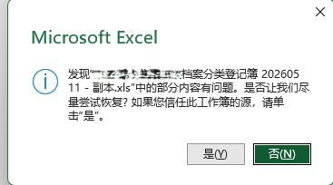
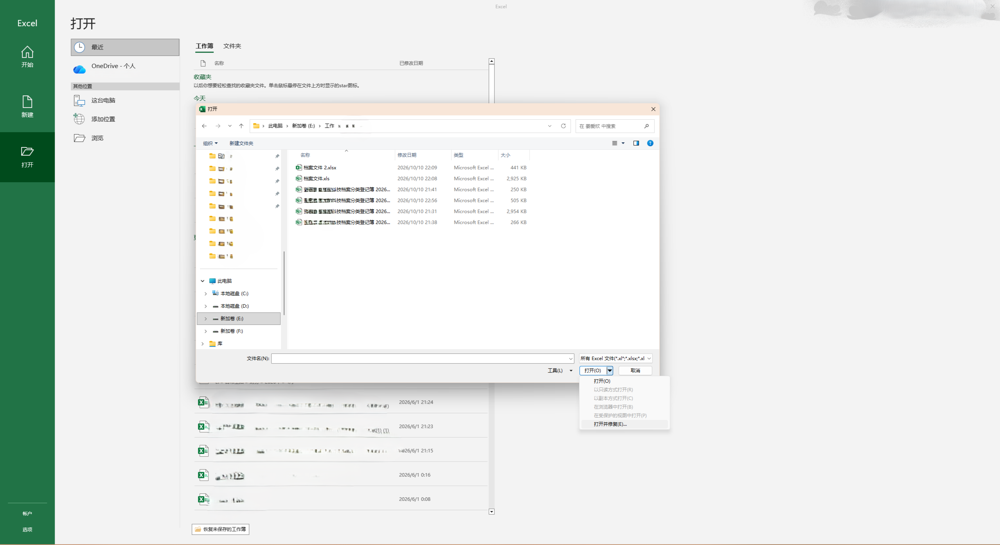
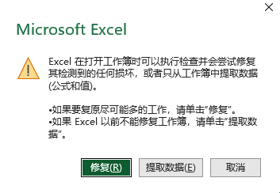
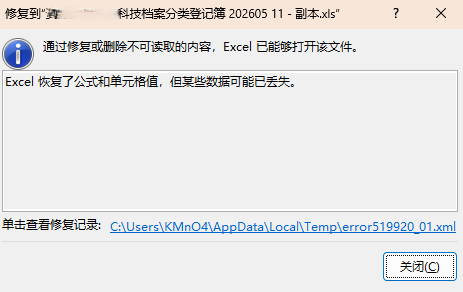
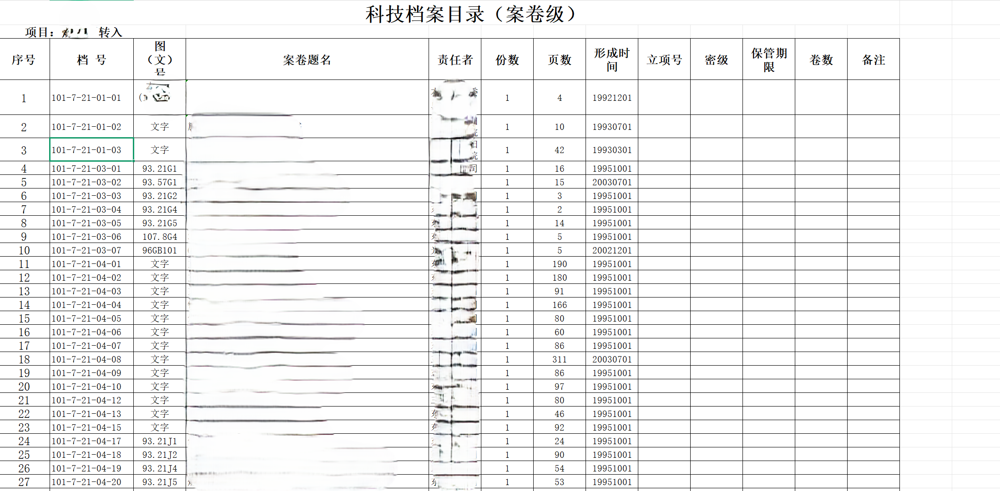

昨天晚上的时候我妈给我布置个任务，让我帮她修改一下Excel表格中的数据，把档案号`101-XX`改为`110-XX`。我心想这不就是用个函数的事吗，结果问题果然没这么简单。

首先我把文件保存到本地之后用我`Windows`上的`Office 2016`打开时报错，报错图如下

于是我就点击`否`，结果卡住半天不出现。

然后我就认为是Excel文件可能损坏，于是尝试修复，结果在点击`是`修复也半天不好使。

后来我上网搜索到一个新的修复方法，就是先打开Excel软件，在`浏览`中选择`打开并修复`

弹出对话框，选择`修复`

等了一会儿之后修复完成，弹出如下弹窗：

检查所有工作表，发现所有工作表的样式都消失了，而且部分表的内容缺失。

而且最关键的需要修改数据的部分遗失了。于是我想到用第三方工具进行修复，搜索了很多但感觉都比较麻烦。

突然间，我注意到该文件的格式是`xls`，不是现在通用的`xlsx`，我开始怀疑起了Excel的兼容性的问题，于是询问我妈之后被告知“同事用笔记本也打不开”，更加坐实了我的猜想。

我妈说用手机能打开，我一试果然可以，那为什么用电脑不行呢？怀着这样的疑问，我打开浏览器搜索，找到`手机内置的文件浏览器比电脑的Office兼容性要好`的结论，于是我就想怎么在电脑上模拟手机的操作环境，第一时间想到手机模拟器，但我这手机是苹果的只能作罢。

然后我又想，既然手机能打开，那能不能在手机上编辑呢？于是我就使用手机下载的WPS软件成功得打开了，突然间我想到会不会电脑上的WPS也能打开该文件呢？我在电脑上现下了WPS，果然可以打开，内容样式均完整，如图。

图中清晰可见错误的档案号`101-XX`

于是问题就简单了，使用`REPLACE`函数实现局部替换就可以了，如图。

## 总结：凡是Office打不开的一律用WPS。

